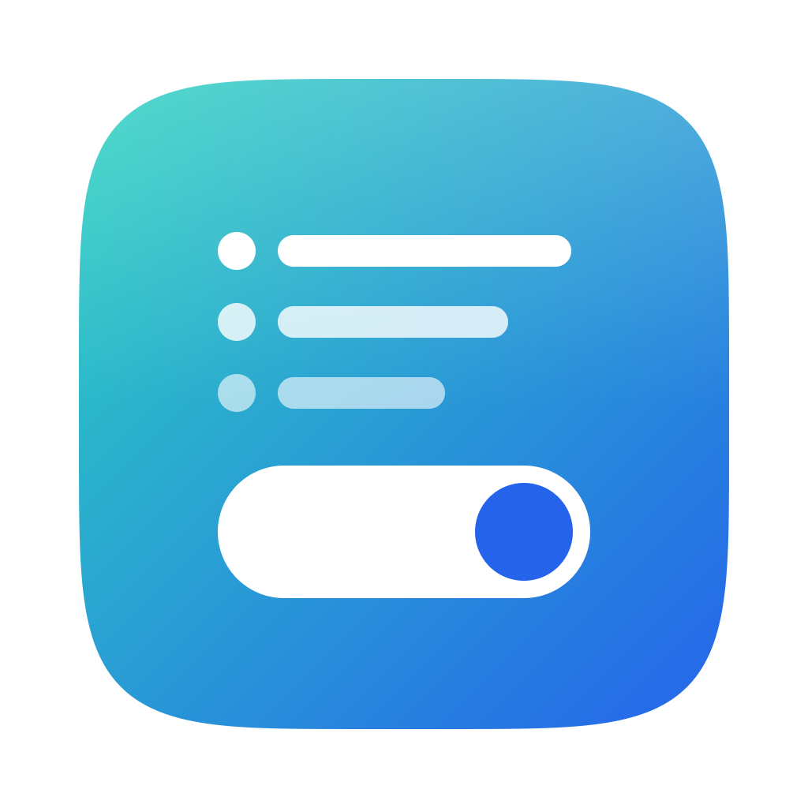
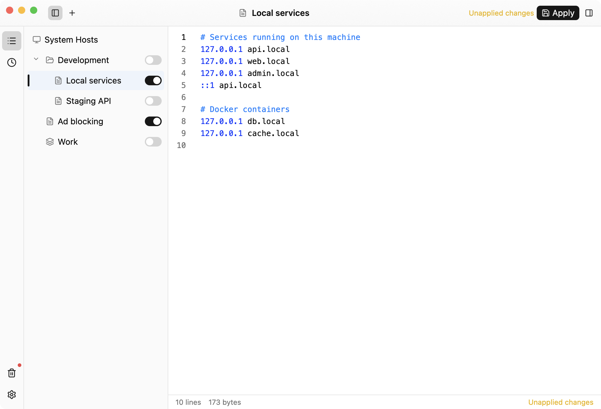
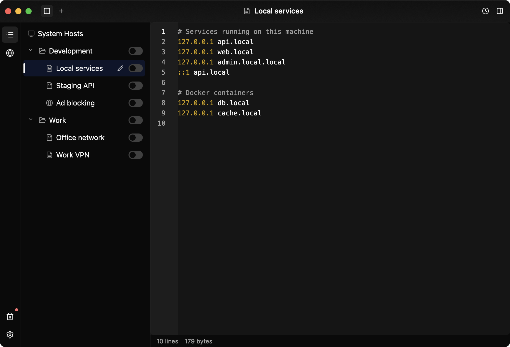
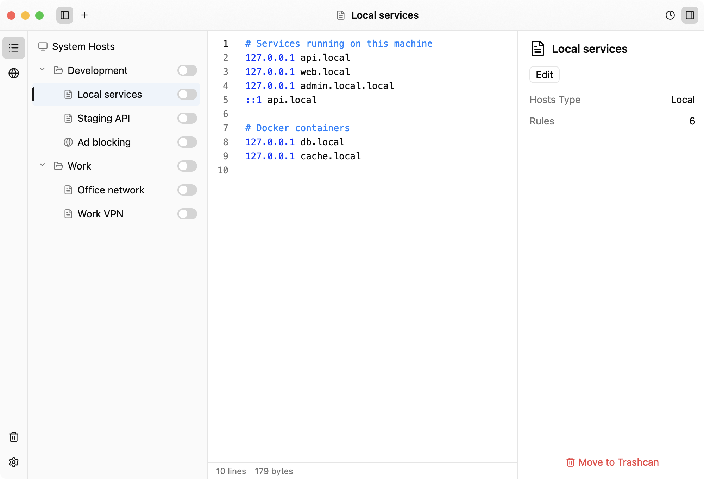
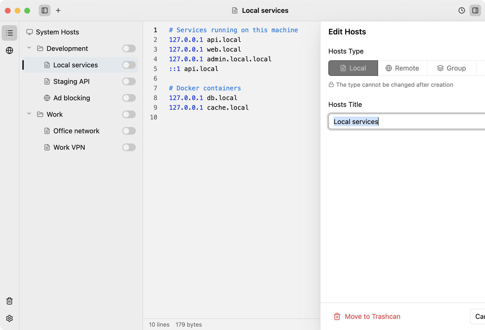
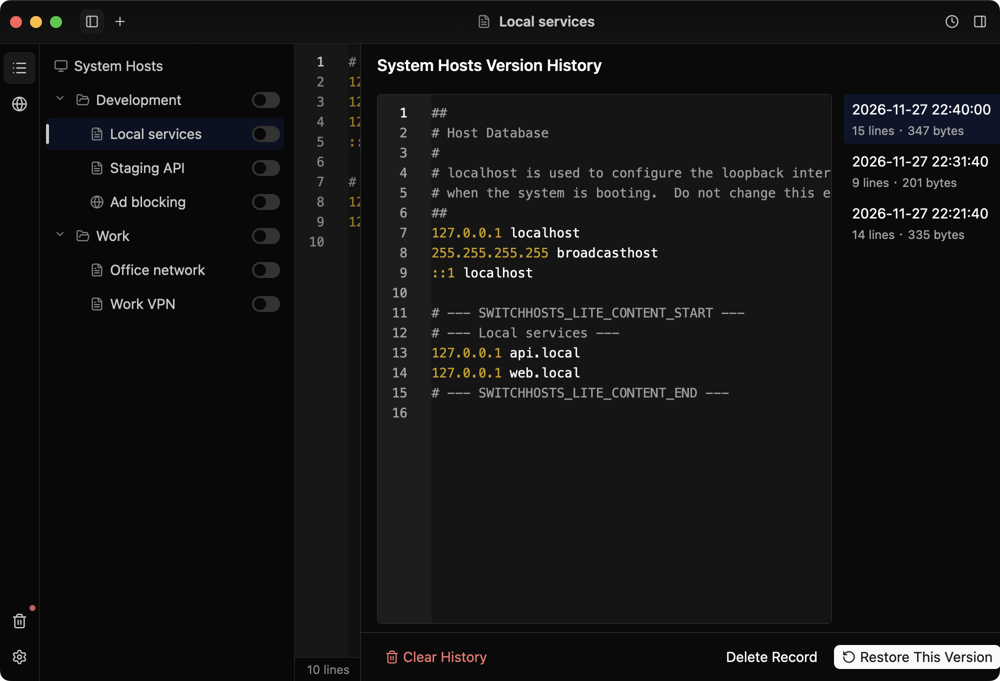
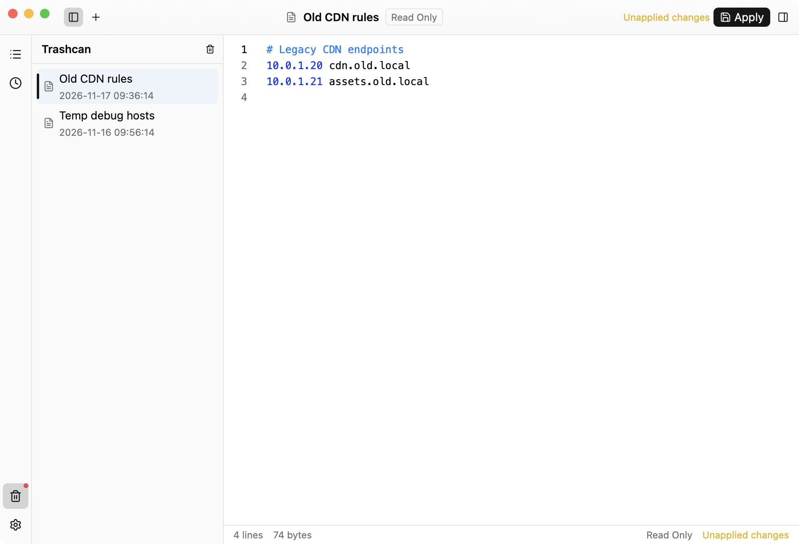
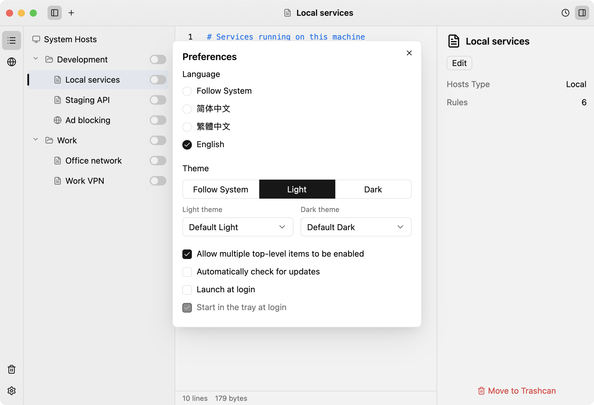

<p align="center">
  
</p>

<h1 align="center">SwitchHosts Lite</h1>

<p align="center">
  <a href="README.md">简体中文</a> | English
</p>

<p align="center">
  <a href="https://github.com/gjfei/SwitchHostsLite/actions/workflows/ci.yml"></a>
  <a href="https://github.com/gjfei/SwitchHostsLite/releases/latest"></a>
</p>

SwitchHosts Lite is a lightweight take on [SwitchHosts](https://github.com/oldj/SwitchHosts): a native desktop app written in Rust with [gpui](https://www.gpui.rs/) / [gpui-component](https://github.com/longbridge/gpui-component) (through `gpui-kit`), with no Electron or WebView. It keeps the core SwitchHosts workflow (split hosts rules into entries, switch them on and off, write them to the system hosts file) and can import SwitchHosts backups. It runs on macOS and Windows.

## Screenshots

<table>
  <tr>
    <td></td>
    <td></td>
  </tr>
</table>

<details>
<summary>More screenshots</summary>











</details>

## Features

- **Three kinds of entries**
  - **Local**: a piece of hosts text you edit yourself.
  - **Folder**: can be nested. Its choice mode is "default" (follows the top-level single/multiple setting), "single" (only one child enabled at a time) or "multiple". Turning a folder on or off turns its children on or off too.
  - **Group**: references local entries and combines their content in the chosen order.
- **Switching applies immediately**: turning an entry on or off writes the system hosts right away. If writing fails (for example, the password prompt was cancelled), the switch reverts.
- **Browser profiles**: without touching the system hosts, each profile turns on the hosts entries it wants in the main panel with its own switches and passes their rules to Chromium as `--host-resolver-rules`, launching Google Chrome or Microsoft Edge with a dedicated or temporary profile. You can also add the rules to your everyday browser profile (quit that browser completely first). Those switches are independent of the system hosts switches.
- **Read-only system hosts view**: the first row of the list shows the current system hosts. If another program changed the file, it is re-read when the window regains focus.
- **Your own entries are kept**: the app only maintains the block between `# --- SWITCHHOSTS_LITE_CONTENT_START ---` and `# --- SWITCHHOSTS_LITE_CONTENT_END ---` at the end of the hosts file. Everything outside the block stays untouched.
- **Trashcan**: deleted entries go to the trashcan first. You can restore them to their original folder (restored entries are switched off), delete them permanently, or empty the trashcan; browser profiles go to the trashcan too and come back with the settings they had.
- **History**: the clock button in the title bar opens the history sheet. Every successful system hosts write that changes the content records the content before and after it (each skipped when it equals the newest entry; up to 50). Browser profiles record every change of name, browser, launch mode, launch path, profile color, profile icon and switches. Both can be viewed, restored or deleted.
- **Import / export**
  - Import SwitchHosts v3 / v4 / v5 backups and the backup format of earlier versions of this app. Importing replaces all current hosts entries; a backup exported by this app also replaces the browser profiles. The replaced content moves to the trashcan.
  - Export in the SwitchHosts v4 format (`swh_data_<time>.json`), which SwitchHosts v4 and v5 can import. Browser profiles are exported together with the hosts records — settings, switches and color are kept, custom pictures and revision history are not (carried in an extension field SwitchHosts ignores).
- **Syntax highlighting**: comments, IP addresses, and lines whose first field is not a valid IP address (shown in the error color).
- **Editor shortcuts**: toggle comment, move line up/down, duplicate line, delete line. See [Keyboard shortcuts](#keyboard-shortcuts).
- **Themes**: follow system / light / dark. 36 bundled color themes (11 light, 25 dark, from gpui-component), chosen separately for light and dark mode, plus your own theme files.
- **Languages**: Simplified Chinese, Traditional Chinese and English, following the system language by default.
- **Auto-apply**: while you edit a local entry, its content is written about 1 second after you stop typing. Adding, deleting, moving or editing entries is written right away too. Both kinds of automatic writes **only happen when no password is needed** (the current user can write the hosts file directly). Otherwise the UI shows "Unapplied changes" and waits for you to apply.
- **Auto-update**: at startup the app looks for a new release on GitHub Releases (at most once a day; can be turned off in Preferences). The download is checked against its size and SHA-256 and installed, then the app restarts. On Windows the installer runs silently and asks for administrator rights; cancelling leaves the current version in place and reopens the app.
- **Low resource usage**: native rendering in a single executable, with far lower memory use and download size than the Electron-based SwitchHosts. The caret stops blinking after about 10 seconds of inactivity, so the window is not redrawn continuously for it.

## Differences from SwitchHosts

- **Browser profiles are new**: SwitchHosts has no such feature. A browser profile turns the rules of the hosts entries it has switched on into launch arguments that only affect the browser process it starts, without writing the system hosts or needing administrator rights.
- **No remote hosts**: hosts cannot be subscribed from a URL. When a SwitchHosts backup is imported, remote entries become local entries holding the content cached in the backup.
- **No tray / menu bar icon**. Closing the window quits the app.
- **No HTTP API, Alfred workflow or other integrations**, and no command-line interface.
- **Folder switches always sync their children**: this matches SwitchHosts with "Sync Child Items When Toggling Folders" turned on. Turning a folder on or off does the same to everything inside it (stopping at folders in single mode). A parent folder turns on once all of its children are on, and turns off as soon as any child is turned off (folders in single mode don't follow their children). The hosts file gets every entry whose own switch is on; a folder's own switch never hides its children. New entries and folders start switched off. In SwitchHosts this syncing is an option (off by default); here it is always on.
- **On/off state after import**: as in SwitchHosts, everything imported from a SwitchHosts backup, folders included, is switched off. Export writes every switch and folder choice mode as is; files exported by this app keep those switches and the "Allow multiple top-level items to be enabled" setting when imported again.
- **Manages only its own block**: the app uses its own `SWITCHHOSTS_LITE_CONTENT_*` markers. Content outside them, including content written by other tools, is kept as is.
- **Top-level choice mode**: "Allow multiple top-level items to be enabled" in the settings menu corresponds to the "Choice Mode" preference of SwitchHosts and defaults to multiple. When it is off, turning a top-level entry on turns the other top-level entries (and their children) off. Changing the setting itself leaves entries that are already on alone. Folders whose choice mode is "default" follow this setting too.

## Download and install

Download the file for your platform from [GitHub Releases](https://github.com/gjfei/SwitchHostsLite/releases/latest) (`<version>` is the version number):

| Platform | File |
| --- | --- |
| macOS, Apple silicon | `SwitchHostsLite-<version>-macos-aarch64.dmg` or `.zip` |
| macOS, Intel | `SwitchHostsLite-<version>-macos-x86_64.dmg` or `.zip` |
| Windows x64 | `SwitchHostsLite-<version>-windows-x86_64-setup.exe` |
| Windows ARM64 | `SwitchHostsLite-<version>-windows-aarch64-setup.exe` |

Every release also carries `SHA256SUMS.txt` (checksums of all files) and `latest.json` (used by the in-app updater).

### macOS

- Requires macOS 11 or later.
- The app is only ad-hoc signed and not notarized by Apple. The first time, **right-click the app in Applications → Open**, or run:

  ```sh
  xattr -dr com.apple.quarantine "/Applications/SwitchHosts Lite.app"
  ```

- **Move the app to the Applications folder** before running it. When opened straight from Downloads or the disk image, macOS runs it from a read-only temporary location (App Translocation), and automatic updates cannot work there.

### Windows

- Run `SwitchHostsLite-<version>-windows-x86_64-setup.exe` (`-windows-aarch64-setup.exe` on ARM64). The installer asks for administrator rights, installs to `C:\Program Files\SwitchHostsLite` by default (the directory can be changed), adds Start Menu and desktop shortcuts for all users, and uninstalls from Settings → Apps.
- The exe is not code-signed, so SmartScreen may say "Windows protected your PC". Click "More info → Run anyway".
- Windows Defender occasionally flags the unsigned exe as a trojan; detection names ending in `!ml` are usually machine-learning false positives. Report it via the [Microsoft file submission](https://www.microsoft.com/en-us/wdsi/filesubmission) or temporarily add the app to Defender's exclusions.
- By default the app is installed under `Program Files`, which ordinary users cannot write to. In-app updates download the installer, run it silently with administrator rights after the app exits, and start the new version (UAC appears; cancelling keeps the current version).

## Usage

### Layout

From left to right, the window has:

1. **Icon bar**: Hosts list, browser profiles, trashcan (with a red dot when not empty), and the settings menu (Import, Export, Preferences, Theme, Allow multiple top-level items to be enabled, Check for Updates, About).
2. **List**: in the hosts view, "System Hosts" first, then your entries; in the browser profiles view, the profile list. The button at the left of the title bar hides the list; while it is hidden, the current entry's switch appears in the title bar.
3. **Main panel**: shows the selected item. Only local entries are editable. System hosts, folders (showing the combined content of the entries inside that are on) and groups (showing the combined content of their entries) are read-only previews; in the browser profiles view this area shows the profile's hosts tree, with the same switches and interactions as the hosts list. The status bar shows the line count, byte count and whether everything is applied; for a browser profile its left side shows the rule count and its right side only the launch state (ready, running, or the reason launching is blocked — no separate warning when there are no rules).
4. **Info panel**: toggled by the button at the right of the title bar. It shows the type, rule count (lines that are neither blank nor comments), a folder's choice mode and child count, a group's entries, a browser profile's settings, and the path of the system hosts.

The dividers between the panels can be dragged to resize them (at least 180 each, and the main panel keeps at least 320). The width is saved on release and restored on the next launch; a narrower window shrinks the panels instead of squeezing the main panel away. The hosts view and the browser view each remember their own list width; in the browser view with the info panel open, the middle hosts tree has its own draggable width and the info panel takes the remaining width.

### Adding and editing entries

- Click **+** in the title bar, or right-click the empty part of the list and choose "Add Hosts Entry". If a folder or an entry inside a folder is selected, the new entry goes into that folder.
- Double-click an entry, click the pencil icon on its row, or right-click → "Edit" to change its title, a folder's choice mode, or a group's entries. The type cannot be changed after creation.
- As in SwitchHosts, drag entries (folders and groups included) in the list to reorder or regroup them: drop on the upper or lower half of a row to place the entry before or after it, or on the middle of a folder row to put it at the end of that folder. Hovering a drag over a collapsed folder for about a second expands it. System hosts and trashcan items can't be dragged, and a folder can't be dropped into itself or its subfolders. Moving never changes switches, but when it changes the order of what is written, the hosts file is updated like for other structural edits (when no password is needed).
- "Move to…" in the context menu moves an entry into another folder or to the top level.
- In the edit sheet, Enter confirms and Esc closes.

### Applying to the system hosts

- Turning a switch on or off writes immediately.
- Click "Apply" in the title bar, or press <kbd>⌘S</kbd> (macOS) / <kbd>Ctrl+S</kbd> (Windows), to write the content of all effective entries to the system hosts.
- What gets written: the system hosts content outside the block + a blank line + the managed block. Each entry in the block starts with `# --- <entry title> ---`; a local entry referenced several times is written only once. When nothing is enabled, the block is removed.
- If the existing hosts file is not UTF-8 encoded, the app refuses to write it so its content is not damaged.

### Browser profiles

A browser profile does not write the system hosts. Each profile turns on the hosts entries it wants in the main panel with its own switches and passes their rules to Chromium as `--host-resolver-rules`, affecting only the browser process it starts, so no administrator rights are needed. The switches are saved per profile and are independent of the system hosts switches.

- Click the globe icon in the icon bar to open the browser profiles view. Create a profile with **+** in the title bar (it starts as "Untitled Profile", and the info panel opens with the name selected, ready to be typed over); edit its name, browser, launch path and launch mode in the info panel.
- Leave the launch path empty to find the browser in the usual install locations, or set the executable path of a portable or custom install by typing it or with the picker button next to the field (choosing a macOS `.app` resolves to the executable inside it).
- Launch modes:
  - **Own profile**: uses a dedicated profile directory in the app data folder; logins survive restarts.
  - **Temporary session**: incognito mode with a temporary directory that is deleted when the browser exits.
  - **Default session**: adds the launch arguments to your everyday browser profile. Quit that browser completely first, or Chromium ignores the arguments; the launch button is disabled while it is running.
- Turn entries on in the main panel's hosts tree just like in the hosts list: a folder's switch passes down to its children, children switch brings the folder on once all of them are on, single-mode folders and the top-level "Allow multiple top-level items to be enabled" rule apply the same way, and folders collapse with the arrow on the left. The rules come from the switched-on entries in list order, and the first rule for a host wins.
- Launch with the "Launch" button in the title bar or by turning on the switch on a row. The switch and the button are disabled, with the reason shown, when nothing is switched on, the browser cannot be found, the command exceeds the limit (32,000 characters on Windows, 262,144 elsewhere), or the profile's browser is still running: Chromium hands the arguments to the running instance and ignores the new rules, so quit it completely before launching again.
- The row's switch stays in sync with the running state: it remains on (green) while the profile's browser runs and turns itself off when it exits, while the status bar shows "Running". Own-profile and temporary-session state is detected through the profile directory in the process command line (`--user-data-dir`), including instances started outside the app or by an earlier app run; a Default profile is the everyday instance — the browser process with no `--user-data-dir` — so launching another profile never makes it look open, and all three modes can be stopped from the switch, the title bar or the context menu. Everything is re-probed every 2 seconds while the browser view is open, so no window switching is needed.
- A running profile can be stopped by turning its row switch off, with the "Stop" button in the title bar or from the context menu, which ends that profile's browser processes (a temporary session's directory is still removed). For a Default profile this quits your everyday browser itself.
- **Profile color and launch marking**: each profile has a color (assigned round-robin from an 8-color palette at creation), changed in the info panel's color picker: the palette is offered as featured colors, and sliders or a hex value allow custom colors; the cross inside the field leaves it empty. The list row and the info panel both draw the same icon: the browser's own icon with a badge in the bottom-right corner whose background is the profile color (a neutral grey while none is set) and whose letter is the profile name's first character; the "Profile icon" row can replace it with your own picture (the picker only lists image files), which carries no badge; hovering the icon reveals a dim scrim with a button to replace the picture and, for a custom picture, a small × in its top-right corner to restore the default icon (macOS and Windows alike; Windows reads the icon straight out of the browser's exe). A color dot before the name appears only when the icon carries no badge (a custom picture). Launching an own-profile or temporary-session instance tints the browser window with that color (`--install-autogenerated-theme`) and marks the system icon: on macOS the same composite is sent over a CDP pipe (`--remote-debugging-pipe`, no network port opened) to replace the icon in the Dock and the ⌘Tab switcher; on Windows the composite is drawn from the executable's own icon resource and handed to the browser window's icon (`WM_SETICON`, best effort — Chrome may repaint over it). On both platforms the profile name and color are synced into the profile directory's `Preferences` and `Local State` on every launch (the browser is quit first), so Chrome's name button shows the profile name. The sync is bidirectional: renames and recolors in the app are pushed to the browser, and when an own-profile instance exits, a name or color changed inside the browser is read back into the app (each as an undoable revision), adopting only fields that differ from what the last launch pushed. An incognito window's name button still shows "Incognito" by Chrome's design; a temporary session's directory is deleted on exit, so nothing is read back. Icons are cached under `profile-tiles/` and custom pictures under `profile-images/` in the data directory, recomposed when the color, name or browser changes. Temporary-session (incognito) windows do not support the tint, only the icon mark; a Default profile is neither tinted nor marked, so the info panel hides both the color and the icon row for it.
- macOS recognizes and can stop instances started by an earlier app run; Windows can only list process names, so own-profile and temporary-session state is tracked only within the current app run there.
- The context menu can duplicate the profile (copying the switches but not the history) or move it to the trashcan. The history sheet records every change of name, browser, launch mode, launch path, profile color, profile icon and switches, and older settings can be restored.

### Permissions

The app first tries to write directly. Without permission:

- **macOS**: an administrator password prompt is shown through `osascript`. After writing, the DNS cache is flushed (`dscacheutil -flushcache`, `killall -HUP mDNSResponder`).
- **Windows**: the app relaunches itself elevated through UAC (the same binary, which only writes the staged hosts), so the UAC prompt appears. Afterwards `ipconfig /flushdns` runs and the file is read back to confirm its content (antivirus software may block the write). A hosts file locked by another program is reported as such.

You can also give the current user write access to the hosts file; then neither writing nor auto-apply asks for authorization.

### Location of the hosts file on Windows

Windows resolves the hosts file in this order (`src/hosts.rs`):

1. `hosts` in the directory named by `DataBasePath` under the registry key `HKLM\SYSTEM\CurrentControlSet\Services\Tcpip\Parameters` (environment variables expanded), if that file exists;
2. otherwise `System32\drivers\etc\hosts` in the Windows directory returned by `GetSystemWindowsDirectoryW`.

macOS always uses `/etc/hosts` with LF line endings; Windows writes CRLF.

### Data location

All data lives in a `SwitchHostsLite` folder in the system configuration directory:

| System | Directory |
| --- | --- |
| macOS | `~/Library/Application Support/SwitchHostsLite/` |
| Windows | `%APPDATA%\SwitchHostsLite\` |

| File | Content |
| --- | --- |
| `data.json` | Entries, browser profiles, trashcan, and the "Allow multiple top-level items to be enabled" setting |
| `history.json` | System hosts history |
| `settings.json` | Language, theme, color themes, automatic update checks and other preferences |
| `profile-tiles/` | Cached composite icons for the browser launch marking |
| `profile-images/` | Custom profile icon pictures |
| `themes/` | Your own theme files |

Files are written to a temporary file in the same directory and then renamed, so a crash mid-write never leaves a broken file. If `data.json` or `settings.json` cannot be parsed, it is renamed to `*.json.bak` and defaults are used. Edits are saved 0.5 seconds after typing stops, and pending edits are saved on quit.

### Custom themes

Put theme files in the gpui-component format (`*.json`) in the `themes/` folder of the data directory above, **restart the app**, and pick them in "Preferences → Light theme / Dark theme". The bundled themes in `assets/themes/` show the format:

```json
{
  "name": "My Theme",
  "themes": [
    {
      "name": "My Theme Dark",
      "mode": "dark",
      "colors": { "background": "#1e1e1e", "foreground": "#d4d4d4" },
      "highlight": { }
    }
  ]
}
```

- A file can hold several themes. `mode` is `light` or `dark`; only the fields you want to override are needed.
- A custom theme with the same name as a bundled one replaces it.
- Files that do not parse are skipped.
- If the selected theme is removed, the default color theme is used.

## Keyboard shortcuts

| Action | macOS | Windows |
| --- | --- | --- |
| Apply to system hosts | <kbd>⌘S</kbd> | <kbd>Ctrl+S</kbd> |
| Toggle comment | <kbd>⌘/</kbd> or <kbd>Ctrl+/</kbd> | <kbd>Ctrl+/</kbd> |
| Move line up | <kbd>⌥↑</kbd> | <kbd>Alt+↑</kbd> |
| Move line down | <kbd>⌥↓</kbd> | <kbd>Alt+↓</kbd> |
| Duplicate line | <kbd>⌘⇧D</kbd> | <kbd>Ctrl+Shift+D</kbd> |
| Delete line | <kbd>⌘⇧K</kbd> | <kbd>Ctrl+Shift+K</kbd> |
| Quit | <kbd>⌘Q</kbd> | <kbd>Ctrl+Q</kbd> |

The editing shortcuts only work while the editor of a local entry has focus. Undo, redo, find (<kbd>⌘F</kbd> / <kbd>Ctrl+F</kbd>) and other shortcuts come from the gpui-component editor.

## Building from source

### Prerequisites

- The Rust toolchain is pinned in `rust-toolchain.toml` (currently 1.99.1); with [rustup](https://rustup.rs/) installed it is downloaded automatically.
- **macOS**: Xcode Command Line Tools (`xcode-select --install`).
- **Windows**: the "Desktop development with C++" workload of Visual Studio Build Tools, including MSVC and the Windows SDK (gpui compiles its shaders with the SDK's `fxc`, and `embed-resource` uses the SDK's resource compiler to embed the icon in the exe).

### Common commands

```sh
cargo run                                   # run a debug build
cargo test                                  # run the tests
cargo clippy --all-targets -- -D warnings   # lint; CI requires zero warnings
cargo build --release                       # release build
```

### Bundling the macOS app

```sh
scripts/bundle-macos.sh                                     # bundle for the host architecture into dist/SwitchHosts Lite.app
scripts/bundle-macos.sh --target x86_64-apple-darwin --out dist
```

The script builds a release binary, writes `Info.plist` (version taken from `Cargo.toml`), copies the icon and signs the bundle ad hoc. Run `rustup target add <target>` before using `--target`.

## Releasing

1. Change `version` in `Cargo.toml` and commit.
2. Tag and push; the tag must match the version:

   ```sh
   git tag v0.2.0
   git push origin v0.2.0
   ```

3. `.github/workflows/release.yml` checks that the tag matches the version, builds macOS (arm64, x86_64) and Windows (x64, ARM64), produces the [files listed above](#download-and-install), writes `SHA256SUMS.txt` and `latest.json` with `scripts/release-manifest.py`, and creates the GitHub Release (with generated release notes). It can also be run by hand from the Actions page with an existing tag.
4. Tags containing `-` (such as `v1.0.0-beta.1`) are published as pre-releases. The in-app updater reads `releases/latest`, which skips pre-releases, so users never get them.

### Update source

The in-app updater fetches `https://github.com/<owner>/<repo>/releases/latest/download/latest.json`. The repository is fixed **at build time**:

- `SHL_UPDATE_REPO=owner/repo` takes precedence (the release workflow sets it to the current repository);
- otherwise `repository` in `Cargo.toml` is used (currently `gjfei/SwitchHostsLite`). If it is set to the `OWNER` placeholder, updates are disabled and the menu shows "Check for Updates (no update source)".

### Optional: code signing

`release.yml` contains commented-out signing steps. Enable them and set these secrets as needed:

- macOS signing and notarization: `MACOS_CERTIFICATE`, `MACOS_CERTIFICATE_PASSWORD`, `MACOS_SIGNING_IDENTITY`, `APPLE_ID`, `APPLE_TEAM_ID`, `APPLE_APP_PASSWORD`
- Windows Authenticode: `WINDOWS_CERTIFICATE`, `WINDOWS_CERTIFICATE_PASSWORD`

## Credits and license

- Features, UI wording and backup formats follow [SwitchHosts](https://github.com/oldj/SwitchHosts) (Apache-2.0). Thanks to oldj and all contributors.
- The UI is built on [gpui](https://www.gpui.rs/) and [gpui-component](https://github.com/longbridge/gpui-component) (through `gpui-kit`, Apache-2.0).
- The bundled color themes come from gpui-component; see [`assets/themes/LICENSE-gpui-component`](assets/themes/LICENSE-gpui-component) (Apache-2.0).
- Icons are from [Lucide](https://lucide.dev/) (ISC).

This project is open source under the [Apache-2.0 License](LICENSE); you are free to use, modify and distribute it.
