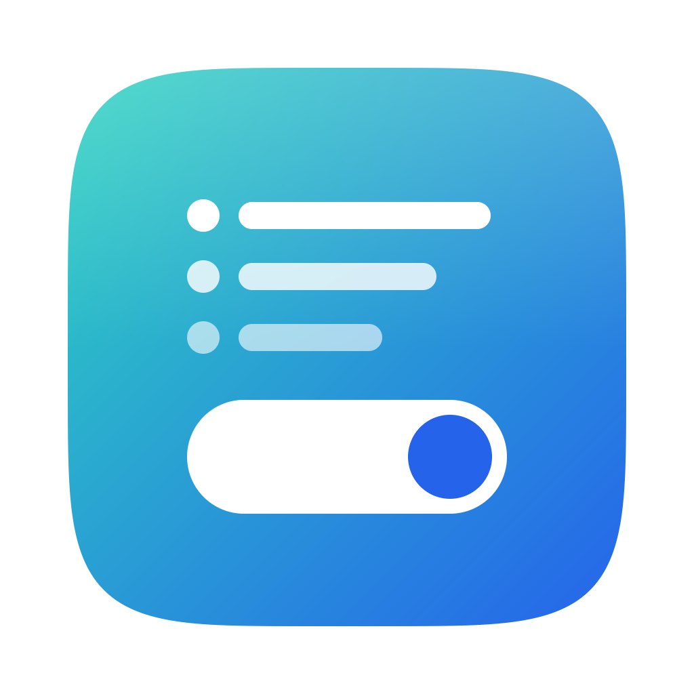

<p align="center">
  
</p>

<h1 align="center">SwitchHosts Lite</h1>

<p align="center">
  简体中文 | <a href="README.en.md">English</a>
</p>

<p align="center">
  <a href="https://github.com/gjfei/SwitchHostsLite/actions/workflows/ci.yml"></a>
  <a href="https://github.com/gjfei/SwitchHostsLite/releases/latest"></a>
</p>

SwitchHosts Lite 是 [SwitchHosts](https://github.com/oldj/SwitchHosts) 的轻量版：用 Rust 和 [gpui](https://www.gpui.rs/) / [gpui-component](https://github.com/longbridge/gpui-component)（通过 `gpui-kit`）写成的原生桌面应用，不依赖 Electron 或 WebView。它保留了 SwitchHosts 的核心用法——把 hosts 规则分成多个方案，按需开关并写入系统 hosts——并且能导入 SwitchHosts 的备份。支持 macOS 和 Windows。

## 功能

- **三种方案类型**
  - **本地**：一段自己编辑的 hosts 文本。
  - **文件夹**：可以嵌套，选择模式分为「默认」（跟随顶层的单选 / 多选设置）、「单选」（同一时间只能启用一个子项）和「多选」；打开或关闭文件夹会同时打开或关闭其下的子项。
  - **组合**：引用若干本地方案，按选择的顺序合并它们的内容。
- **开关即生效**：打开或关闭方案后立即写入系统 hosts；写入失败（例如取消了授权）时开关会自动恢复原状。
- **系统 hosts 只读查看**：左侧列表第一项是系统 hosts 的当前内容；切回窗口时如果文件被其他程序改过，会自动重新读取。
- **保留原有内容**：应用只维护 hosts 文件末尾由 `# --- SWITCHHOSTS_LITE_CONTENT_START ---` 和 `# --- SWITCHHOSTS_LITE_CONTENT_END ---` 包围的区块，区块之外你自己写的内容不会被改动。
- **回收站**：删除的方案先进回收站，可以还原到原来的文件夹（还原后为关闭状态），也可以彻底删除或清空。
- **系统 hosts 历史版本**：每次写入成功且内容有变化时，会依次记录写入前和写入后的系统 hosts（与最新一份相同则跳过，最多 50 份），可以查看、恢复到某个版本或删除。
- **导入 / 导出**
  - 导入 SwitchHosts v3 / v4 / v5 的备份文件，以及本应用旧版的备份格式。导入会替换当前全部方案，原有方案移到回收站。
  - 导出为 SwitchHosts v4 格式（`swh_data_<时间>.json`），SwitchHosts v4 和 v5 都能导入。
- **语法高亮**：注释、IP 地址，以及首个字段不是合法 IP 的行（标为错误色）。
- **编辑器快捷键**：切换注释、上下移动行、复制行、删除行，见[快捷键](#快捷键)。
- **主题**：跟随系统 / 浅色 / 深色；内置 36 套配色（11 套浅色、25 套深色，来自 gpui-component），浅色和深色可以分别选择；也可以放入自定义主题文件。
- **多语言**：简体中文、繁體中文、English，默认跟随系统语言。
- **自动应用**：编辑本地方案的内容时，停止输入约 1 秒后自动写入；增删、移动、修改方案等改动也会直接写入。这两种自动写入**只在无需输入密码**（当前用户可以直接写 hosts 文件）时进行，否则界面显示「有未应用的更改」，等你手动应用。
- **自动更新**：启动后检查 GitHub Releases 上的新版本（每天最多一次，可在偏好设置中关闭），下载后校验大小和 SHA-256，原地替换并重启。
- **资源占用低**：原生渲染、单个可执行文件，内存占用和安装包体积都远小于 Electron 版 SwitchHosts；空闲约 10 秒后光标停止闪烁，不再因此持续重绘窗口。

## 与 SwitchHosts 的差异

- **没有远程 hosts**：不能从 URL 订阅 hosts。导入 SwitchHosts 备份时，远程方案会变成本地方案，保留备份里已缓存的内容。
- **没有托盘 / 菜单栏图标**，关闭窗口即退出应用。
- **没有 HTTP API、Alfred 等外部集成**，也没有命令行接口。
- **文件夹开关始终同步子项**：与 SwitchHosts 打开「切换文件夹时同步子项目」时的行为一致：打开或关闭文件夹会同时打开或关闭其下所有子项（遇到单选模式的文件夹时不再向下同步）；子项全部打开时上级文件夹随之打开，任一子项关闭时上级文件夹随之关闭（单选模式的文件夹不跟随子项）。写入 hosts 的是所有自身开关打开的方案，文件夹自身的开关不会屏蔽其中的子项。新建的方案和文件夹默认关闭。SwitchHosts 中这项同步是可选设置（默认关闭），本应用始终开启。
- **导入后的开关状态**：与 SwitchHosts 一致，导入 SwitchHosts 备份后所有方案（包括文件夹）都是关闭的。导出时按原样写入每个方案的开关状态和文件夹的选择模式；本应用自己导出的文件再导入时会保留这些开关状态和「允许同时启用多个顶层方案」设置。
- **只管理自己的区块**：使用自己的 `SWITCHHOSTS_LITE_CONTENT_*` 标记，标记之外的内容（包括其他工具写入的内容）原样保留。
- **顶层单选 / 多选**：设置菜单里的「允许同时启用多个顶层方案」对应 SwitchHosts 偏好设置中的「选择模式」，默认为多选。关闭后，打开一个顶层方案会关闭其他顶层方案（连同其中的子项）；切换这项设置本身不会改动已打开的方案。选择模式为「默认」的文件夹也跟随这项设置。

## 下载安装

从 [GitHub Releases](https://github.com/gjfei/SwitchHostsLite/releases/latest) 下载对应平台的文件（`<版本>` 为版本号）：

| 平台 | 文件 |
| --- | --- |
| macOS Apple 芯片 | `SwitchHostsLite-<版本>-macos-aarch64.dmg` 或 `.zip` |
| macOS Intel | `SwitchHostsLite-<版本>-macos-x86_64.dmg` 或 `.zip` |
| Windows x64 | `SwitchHostsLite-<版本>-windows-x86_64.zip` |
| Windows ARM64 | `SwitchHostsLite-<版本>-windows-aarch64.zip` |

每个版本还附带 `SHA256SUMS.txt`（所有文件的校验和）和 `latest.json`（供应用内更新使用）。

### macOS

- 要求 macOS 11 或更高版本。
- 安装包只做了 ad-hoc 签名，没有经过 Apple 公证。第一次打开时请在「应用程序」中**右键点击应用 → 打开**；或者执行：

  ```sh
  xattr -dr com.apple.quarantine "/Applications/SwitchHosts Lite.app"
  ```

- 请先把应用**移动到「应用程序」文件夹**再运行。直接从下载目录或磁盘映像中打开时，系统会从只读的临时位置运行它（App Translocation），这种情况下无法自动更新。

### Windows

- 解压后直接运行 `switch-hosts-lite.exe`，无需安装。
- 程序没有代码签名，SmartScreen 可能提示「Windows 已保护你的电脑」，点击「更多信息 → 仍要运行」即可。
- Windows Defender 偶尔会把未签名的 exe 误报为木马（检测名以 `!ml` 结尾的多为机器学习误报）。可在 [Microsoft 提交文件分析](https://www.microsoft.com/en-us/wdsi/filesubmission) 反馈，或临时把程序加入 Defender 排除项。
- 自动更新会替换 exe 所在目录中的文件，请把它放在当前用户可写的目录（例如不要放在 `C:\Program Files` 下）。
- 自动更新通过系统自带的 `curl.exe` 下载（Windows 10 1803 及以上版本自带）。

## 使用说明

### 界面布局

窗口从左到右依次是：

1. **图标栏**：Hosts 列表、历史版本、回收站（不为空时带红点）、设置菜单（导入、导出、偏好设置、主题、允许同时启用多个顶层方案、检查更新、关于）。
2. **方案列表**：第一项是「系统 Hosts」，下面是你的方案。可以用标题栏左侧的按钮隐藏列表；隐藏后，当前方案的开关显示在标题栏中。
3. **编辑器**：显示当前选中项的内容。只有本地方案可以编辑；系统 hosts、文件夹（显示其中已开启方案的合并内容）和组合（显示所含方案的合并内容）都是只读预览。底部状态栏显示行数、字节数和是否已应用。
4. **信息面板**：用标题栏右侧的按钮打开，显示类型、规则数（非空、非注释的行数）、文件夹的选择模式和子项数、组合包含的方案，以及系统 hosts 的路径。

### 添加和编辑方案

- 点击标题栏的 **+**，或在列表空白处右键选择「添加 hosts」。如果当前选中的是文件夹或文件夹中的方案，新方案会添加到该文件夹里。
- 双击方案、点击行上的铅笔图标，或右键选择「编辑」，可以修改标题、文件夹的选择模式、组合包含的方案。类型在创建后不能修改。
- 和 SwitchHosts 一样，可以在列表中拖拽方案（包括文件夹和组合）来调整顺序或层级：拖到一行的上半部分或下半部分放在它前面或后面；拖到文件夹行的中间放进该文件夹的末尾。拖拽悬停在折叠的文件夹上约 1 秒会自动展开。系统 hosts 和回收站中的项目不能拖拽，文件夹也不能拖进自身或其子文件夹。移动不会改变方案的开关状态，但写入顺序变化时会像其他结构修改一样自动更新 hosts（不需要输入密码时）。
- 右键菜单的「移动到…」可以把方案移到其他文件夹或顶层。
- 在编辑面板中按 Enter 确认，按 Esc 关闭。

### 应用到系统 hosts

- 打开或关闭方案的开关会立即写入。
- 点击标题栏的「应用」按钮，或按 <kbd>⌘S</kbd>（macOS）/ <kbd>Ctrl+S</kbd>（Windows），把所有已生效方案的内容写入系统 hosts。
- 写入的内容为：系统 hosts 中区块之外的原有内容 + 一个空行 + 受管理的区块。区块中每个方案以 `# --- <方案标题> ---` 开头；同一个本地方案即使被多次引用也只写入一次。没有任何生效方案时，区块会被移除。
- 如果现有的 hosts 文件不是 UTF-8 编码，应用会拒绝写入，以免破坏原有内容。

### 权限

先尝试直接写入；没有权限时：

- **macOS**：通过 `osascript` 弹出管理员密码对话框，写入后刷新 DNS 缓存（`dscacheutil -flushcache`、`killall -HUP mDNSResponder`）。
- **Windows**：通过 UAC 以管理员身份重新启动应用自身来写入（会弹出 UAC 提示）；写入后执行 `ipconfig /flushdns`，并回读文件确认内容一致（防止被杀毒软件拦截）。hosts 被其他程序占用时会给出提示。

你也可以自行让当前用户对 hosts 文件拥有写权限，这样写入和自动应用都不会再弹出授权提示。

### Windows 上 hosts 文件的位置

Windows 按以下顺序确定 hosts 文件（`src/hosts.rs`）：

1. 注册表 `HKLM\SYSTEM\CurrentControlSet\Services\Tcpip\Parameters` 中的 `DataBasePath`（展开环境变量）目录下的 `hosts`，前提是这个文件存在；
2. 否则使用 `GetSystemWindowsDirectoryW` 返回的 Windows 目录下的 `System32\drivers\etc\hosts`。

macOS 固定为 `/etc/hosts`，使用 LF 换行；Windows 上使用 CRLF 换行。

### 数据位置

所有数据保存在系统配置目录下的 `SwitchHostsLite` 文件夹中：

| 系统 | 目录 |
| --- | --- |
| macOS | `~/Library/Application Support/SwitchHostsLite/` |
| Windows | `%APPDATA%\SwitchHostsLite\` |

| 文件 | 内容 |
| --- | --- |
| `data.json` | 方案、回收站，以及「允许同时启用多个顶层方案」设置 |
| `history.json` | 系统 hosts 历史版本 |
| `settings.json` | 语言、主题、配色、自动检查更新等偏好设置 |
| `themes/` | 自定义主题文件 |

文件先写入同目录的临时文件再重命名，避免中途崩溃导致文件损坏。`data.json` 或 `settings.json` 无法解析时，会被重命名为 `*.json.bak` 保留下来，然后使用默认值。编辑内容在停止输入 0.5 秒后保存，退出时会保存尚未写入的修改。

### 自定义主题

把 gpui-component 格式的主题文件（`*.json`）放进上面数据目录下的 `themes/` 文件夹，**重启应用**后即可在「偏好设置 → 浅色配色 / 深色配色」中选择。格式可以参考 `assets/themes/` 中的内置主题：

```json
{
  "name": "My Theme",
  "themes": [
    {
      "name": "My Theme Dark",
      "mode": "dark",
      "colors": { "background": "#1e1e1e", "foreground": "#d4d4d4" },
      "highlight": { }
    }
  ]
}
```

- 一个文件中可以包含多个主题，`mode` 为 `light` 或 `dark`，只需写出要覆盖的字段。
- 与内置主题同名的自定义主题会替换内置主题。
- 无法解析的文件会被跳过。
- 已选主题被删除后，会回退到默认配色。

## 快捷键

| 操作 | macOS | Windows |
| --- | --- | --- |
| 应用到系统 hosts | <kbd>⌘S</kbd> | <kbd>Ctrl+S</kbd> |
| 切换注释 | <kbd>⌘/</kbd> 或 <kbd>Ctrl+/</kbd> | <kbd>Ctrl+/</kbd> |
| 上移行 | <kbd>⌥↑</kbd> | <kbd>Alt+↑</kbd> |
| 下移行 | <kbd>⌥↓</kbd> | <kbd>Alt+↓</kbd> |
| 复制行 | <kbd>⌘⇧D</kbd> | <kbd>Ctrl+Shift+D</kbd> |
| 删除行 | <kbd>⌘⇧K</kbd> | <kbd>Ctrl+Shift+K</kbd> |
| 退出 | <kbd>⌘Q</kbd> | <kbd>Ctrl+Q</kbd> |

编辑类快捷键只在本地方案的编辑器获得焦点时有效。撤销、重做、查找（<kbd>⌘F</kbd> / <kbd>Ctrl+F</kbd>）等其他快捷键由 gpui-component 的编辑器提供。

## 从源码构建

### 准备

- Rust 工具链版本固定在 `rust-toolchain.toml`（当前为 1.99.1），安装 [rustup](https://rustup.rs/) 后会自动下载。
- **macOS**：Xcode Command Line Tools（`xcode-select --install`）。
- **Windows**：安装 Visual Studio Build Tools 中的「使用 C++ 的桌面开发」工作负载，包括 MSVC 和 Windows SDK（gpui 用 SDK 中的 `fxc` 编译着色器，`embed-resource` 用 SDK 中的资源编译器把图标嵌入 exe）。

### 常用命令

```sh
cargo run                                   # 调试运行
cargo test                                  # 运行测试
cargo clippy --all-targets -- -D warnings   # 静态检查，CI 要求零警告
cargo build --release                       # 发布构建
```

### 打包 macOS 应用

```sh
scripts/bundle-macos.sh                                     # 为本机架构打包，输出 dist/SwitchHosts Lite.app
scripts/bundle-macos.sh --target x86_64-apple-darwin --out dist
```

脚本会构建发布版、生成 `Info.plist`（版本号取自 `Cargo.toml`）、复制图标并做 ad-hoc 签名。使用 `--target` 前需要先执行 `rustup target add <target>`。

## 发布流程

1. 修改 `Cargo.toml` 中的 `version`，提交。
2. 打标签并推送，标签必须与版本号一致：

   ```sh
   git tag v0.2.0
   git push origin v0.2.0
   ```

3. `.github/workflows/release.yml` 会先检查标签和版本号是否一致，然后构建 macOS（arm64、x86_64）和 Windows（x64、ARM64），生成[上面列出的文件](#下载安装)，再用 `scripts/release-manifest.py` 生成 `SHA256SUMS.txt` 和 `latest.json`，最后创建 GitHub Release（更新说明自动生成）。也可以在 Actions 页面手动运行，输入一个已有的标签。
4. 带 `-` 的标签（例如 `v1.0.0-beta.1`）会发布为预发布版本。应用内更新读取的是 `releases/latest`，会跳过预发布版本，所以用户不会收到这些版本。

### 更新源

应用内更新从 `https://github.com/<owner>/<repo>/releases/latest/download/latest.json` 获取信息，仓库在**编译时**确定：

- 优先使用环境变量 `SHL_UPDATE_REPO=owner/repo`（发布流程会自动设为当前仓库）；
- 否则使用 `Cargo.toml` 中的 `repository`（当前为 `gjfei/SwitchHostsLite`）。若改为占位符 `OWNER`，更新功能会关闭，菜单中显示「检查更新（未配置更新源）」。

### 可选：代码签名

`release.yml` 中有注释掉的签名步骤，按需启用并配置以下 Secrets：

- macOS 签名与公证：`MACOS_CERTIFICATE`、`MACOS_CERTIFICATE_PASSWORD`、`MACOS_SIGNING_IDENTITY`、`APPLE_ID`、`APPLE_TEAM_ID`、`APPLE_APP_PASSWORD`
- Windows Authenticode：`WINDOWS_CERTIFICATE`、`WINDOWS_CERTIFICATE_PASSWORD`

## 致谢与许可

- 功能设计、界面文案和备份格式参考了 [SwitchHosts](https://github.com/oldj/SwitchHosts)（Apache-2.0），感谢 oldj 和所有贡献者。
- UI 基于 [gpui](https://www.gpui.rs/) 和 [gpui-component](https://github.com/longbridge/gpui-component)（通过 `gpui-kit`，Apache-2.0）。
- 内置配色来自 gpui-component，许可见 [`assets/themes/LICENSE-gpui-component`](assets/themes/LICENSE-gpui-component)（Apache-2.0）。
- 图标来自 [Lucide](https://lucide.dev/)（ISC）。

本项目基于 [Apache-2.0 许可证](LICENSE)开源，欢迎自由使用、修改和分发。
