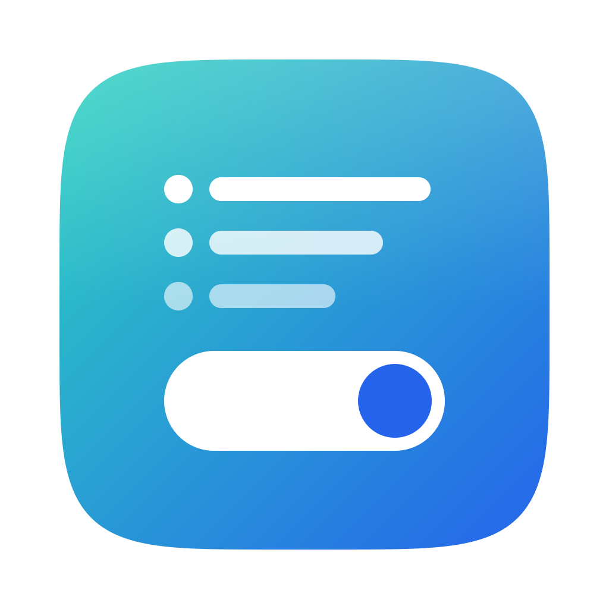
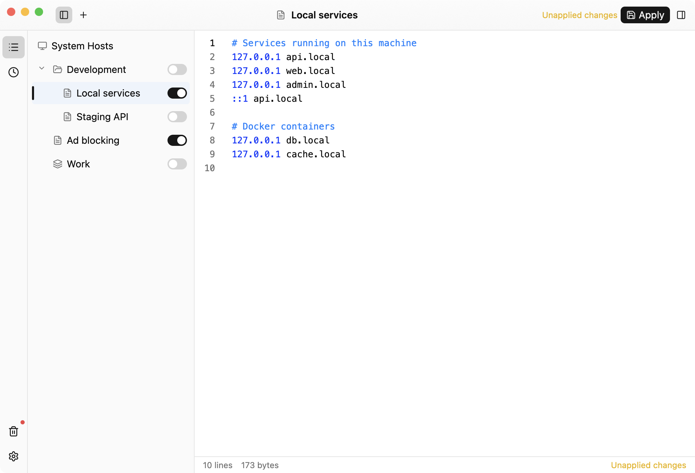
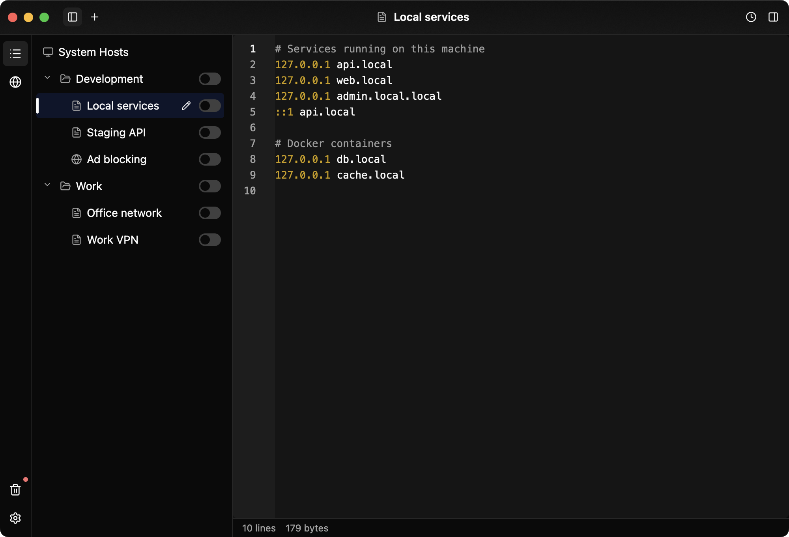
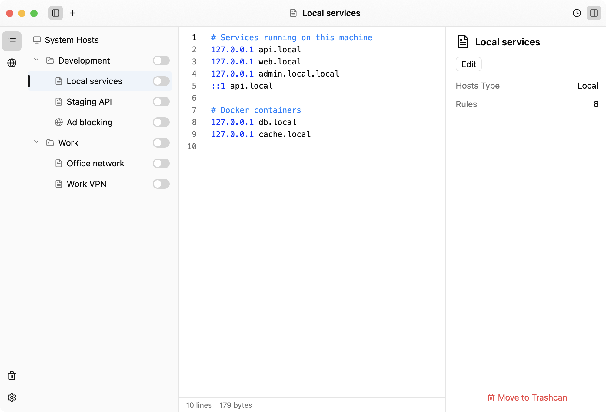
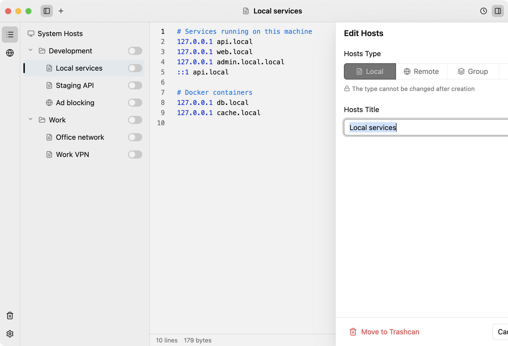
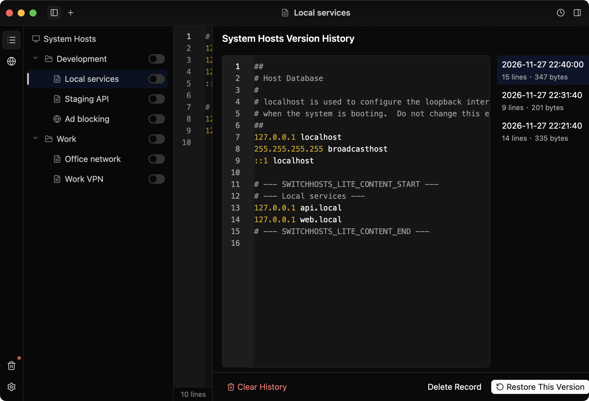
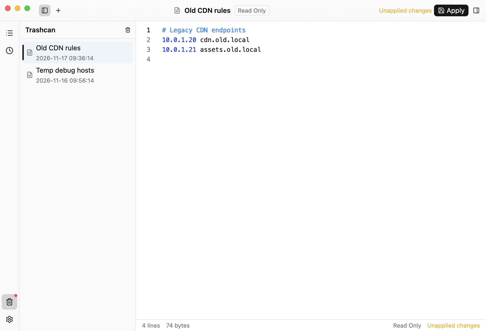
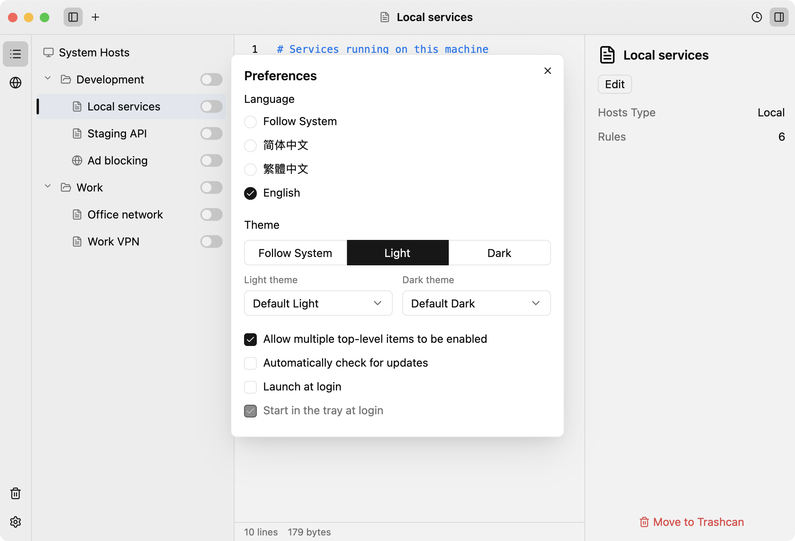

<p align="center">
  
</p>

<h1 align="center">SwitchHosts Lite</h1>

<p align="center">
  简体中文 | <a href="README.en.md">English</a>
</p>

<p align="center">
  <a href="https://github.com/gjfei/SwitchHostsLite/actions/workflows/ci.yml"></a>
  <a href="https://github.com/gjfei/SwitchHostsLite/releases/latest"></a>
</p>

SwitchHosts Lite 是 [SwitchHosts](https://github.com/oldj/SwitchHosts) 的轻量版：用 Rust 和 [gpui](https://www.gpui.rs/) / [gpui-component](https://github.com/longbridge/gpui-component)（通过 `gpui-kit`）写成的原生桌面应用，不依赖 Electron 或 WebView。它保留了 SwitchHosts 的核心用法——把 hosts 规则分成多个方案，按需开关并写入系统 hosts——并且能导入 SwitchHosts 的备份。支持 macOS 和 Windows。

## 界面预览

<table>
  <tr>
    <td></td>
    <td></td>
  </tr>
</table>

<details>
<summary>更多界面截图</summary>











</details>

## 功能

- **四种方案类型**
  - **本地**：一段自己编辑的 hosts 文本。
  - **远程**：从 http(s) URL 订阅 hosts 内容，可手动或按固定间隔刷新，内容只读，见[远程 hosts](#远程-hosts)。
  - **文件夹**：可以嵌套，选择模式分为「默认」（跟随顶层的单选 / 多选设置）、「单选」（同一时间只能启用一个子项）和「多选」；打开或关闭文件夹会同时打开或关闭其下的子项。
  - **组合**：引用若干方案，按选择的顺序合并它们的内容。
- **开关即生效**：打开或关闭方案后立即写入系统 hosts；写入失败（例如取消了授权）时开关会自动恢复原状。
- **托盘图标**：关闭窗口把应用隐藏到托盘（macOS 菜单栏 / Windows 通知区域）而不是退出；托盘菜单只有「显示主窗口」和「退出」，退出前会保存尚未写入的修改。macOS 上点击 Dock 图标也能恢复窗口。
- **开机启动**：偏好设置中勾选后立即生效（macOS 写 LaunchAgent，Windows 写当前用户的 Run 注册表项）；启动时若条目缺失或指向旧路径会自动修复；Windows 卸载时一并清除注册表项。
- **浏览器方案**：不改系统 hosts，在主面板中用自己的开关打开要使用的 hosts 条目，把其中的规则作为 Chromium 的 `--host-resolver-rules` 启动参数，用独立或临时的浏览器配置打开 Google Chrome 或 Microsoft Edge；也可以给日常使用的浏览器配置加上这些规则（需要先完全退出该浏览器）。这些开关与系统 hosts 的开关互不影响。
- **系统 hosts 只读查看**：左侧列表第一项是系统 hosts 的当前内容；切回窗口时如果文件被其他程序改过，会自动重新读取。
- **保留原有内容**：应用只维护 hosts 文件末尾由 `# --- SWITCHHOSTS_LITE_CONTENT_START ---` 和 `# --- SWITCHHOSTS_LITE_CONTENT_END ---` 包围的区块，区块之外你自己写的内容不会被改动。
- **回收站**：删除的方案先进回收站，可以还原到原来的文件夹（还原后为关闭状态），也可以彻底删除或清空；浏览器方案同样放入回收站，还原后保持在删除前的设置。
- **历史版本**：标题栏的时钟按钮打开历史面板。系统 hosts 每次写入成功且内容有变化时，会依次记录写入前和写入后的内容（与最新一份相同则跳过，最多 50 份）；浏览器方案会记录名称、浏览器、启动方式、启动路径、方案色、方案图标和开关的每次修改，都可以查看、恢复到某个版本或删除。
- **导入 / 导出**
  - 导入 SwitchHosts v3 / v4 / v5 的备份文件，以及本应用旧版的备份格式。导入会替换当前全部 hosts 方案；本应用导出的备份还会替换浏览器方案，原有内容移到回收站。远程方案导入后保留 URL 与刷新间隔（内容先用备份里的缓存）。
  - 导出为 SwitchHosts v4 格式（`swh_data_<时间>.json`），SwitchHosts v4 和 v5 都能导入，远程方案按 remote 类型写回。浏览器方案随 hosts 记录一起导出，保留设置、开关与颜色，不含自定义图片和历史记录（写在 SwitchHosts 会忽略的扩展字段里）。
- **语法高亮**：注释、IP 地址，以及首个字段不是合法 IP 的行（标为错误色）。
- **编辑器快捷键**：切换注释、上下移动行、复制行、删除行，见[快捷键](#快捷键)。
- **主题**：跟随系统 / 浅色 / 深色；内置 36 套配色（11 套浅色、25 套深色，来自 gpui-component），浅色和深色可以分别选择；也可以放入自定义主题文件。
- **多语言**：简体中文、繁體中文、English，默认跟随系统语言。
- **自动应用**：编辑本地方案的内容时，停止输入约 1 秒后自动写入；增删、移动、修改方案等改动也会直接写入。没有写权限时会请求授权：macOS 每次运行只需输入一次密码，之后的写入静默完成；Windows 每次写入弹出 UAC 提示（与 SwitchHosts 一致）。
- **更新**：启动后检查 GitHub Releases 上的新版本（每天最多一次，可在偏好设置中关闭），下载时校验大小和 SHA-256，进度显示在对话框里。下载完成后 Windows 点击「重启更新」才静默安装并重启（会出现 UAC 提示，取消则保留当前版本）；macOS 先选择保存文件夹（默认是「下载」目录），下载完成后点击「在 Finder 中显示」，自行挂载磁盘映像拖入「应用程序」安装；安装包被移动或删除后，更新对话框会恢复「立即更新」，可重新下载。测试版和正式版都会收到新版本提示；从正式版更新到测试版时，下载前会先要求确认。
- **资源占用低**：原生渲染、单个可执行文件，内存占用和安装包体积都远小于 Electron 版 SwitchHosts；空闲约 10 秒后光标停止闪烁，不再因此持续重绘窗口。

## 与 SwitchHosts 的差异

- **新增浏览器方案**：SwitchHosts 没有这项功能。浏览器方案把打开的 hosts 条目的规则转换成启动参数，只影响启动的浏览器进程，不写入系统 hosts，因此不需要管理员权限。
- **没有 HTTP API、Alfred 等外部集成**，也没有命令行接口。
- **文件夹开关始终同步子项**：与 SwitchHosts 打开「切换文件夹时同步子项目」时的行为一致：打开或关闭文件夹会同时打开或关闭其下所有子项（遇到单选模式的文件夹时不再向下同步）；子项全部打开时上级文件夹随之打开，任一子项关闭时上级文件夹随之关闭（单选模式的文件夹不跟随子项）。写入 hosts 的是所有自身开关打开的方案，文件夹自身的开关不会屏蔽其中的子项。新建的方案和文件夹默认关闭。SwitchHosts 中这项同步是可选设置（默认关闭），本应用始终开启。
- **导入后的开关状态**：与 SwitchHosts 一致，导入 SwitchHosts 备份后所有方案（包括文件夹）都是关闭的。导出时按原样写入每个方案的开关状态和文件夹的选择模式；本应用自己导出的文件再导入时会保留这些开关状态和「允许同时启用多个顶层方案」设置。
- **只管理自己的区块**：使用自己的 `SWITCHHOSTS_LITE_CONTENT_*` 标记，标记之外的内容（包括其他工具写入的内容）原样保留。
- **顶层单选 / 多选**：设置菜单里的「允许同时启用多个顶层方案」对应 SwitchHosts 偏好设置中的「选择模式」，默认为多选。关闭后，打开一个顶层方案会关闭其他顶层方案（连同其中的子项）；切换这项设置本身不会改动已打开的方案。选择模式为「默认」的文件夹也跟随这项设置。

## 下载安装

从 [GitHub Releases](https://github.com/gjfei/SwitchHostsLite/releases/latest) 下载对应平台的文件（`<版本>` 为版本号）：

| 平台 | 文件 |
| --- | --- |
| macOS Apple 芯片 | `SwitchHostsLite-<版本>-macos-aarch64.dmg` 或 `.zip` |
| macOS Intel | `SwitchHostsLite-<版本>-macos-x86_64.dmg` 或 `.zip` |
| Windows x64 | `SwitchHostsLite-<版本>-windows-x86_64-setup.exe` |
| Windows ARM64 | `SwitchHostsLite-<版本>-windows-aarch64-setup.exe` |

每个版本还附带 `SHA256SUMS.txt`（所有文件的校验和）和 `latest.json`（供应用内更新使用）。

### macOS

- 要求 macOS 11 或更高版本。
- 安装包只做了 ad-hoc 签名，没有经过 Apple 公证。第一次打开时请在「应用程序」中**右键点击应用 → 打开**；或者执行：

  ```sh
  xattr -dr com.apple.quarantine "/Applications/SwitchHosts Lite.app"
  ```

- 请先把应用**移动到「应用程序」文件夹**再运行。直接从下载目录或磁盘映像中打开时，系统会从只读的临时位置运行它（App Translocation）。
- macOS 的应用内更新只负责下载：选择文件夹（默认「下载」目录）后把磁盘映像保存进去，下载完成后点「在 Finder 中显示」定位文件，自行挂载并拖入「应用程序」覆盖安装。安装包被移动或删除后，更新对话框会提示并恢复「立即更新」重新下载。应用内下载的安装包不带隔离标记，覆盖后可以直接启动，不需要右键打开或执行 xattr。

### Windows

- 运行 `SwitchHostsLite-<版本>-windows-x86_64-setup.exe`（ARM64 对应 `-windows-aarch64-setup.exe`）安装：安装程序会请求管理员权限，默认装到 `C:\Program Files\SwitchHostsLite`（安装时可以更改目录），为所有用户创建开始菜单和桌面快捷方式，可在「设置 → 应用」中卸载。
- 程序没有代码签名，SmartScreen 可能提示「Windows 已保护你的电脑」，点击「更多信息 → 仍要运行」即可。
- Windows Defender 偶尔会把未签名的 exe 误报为木马（检测名以 `!ml` 结尾的多为机器学习误报）。可在 [Microsoft 提交文件分析](https://www.microsoft.com/en-us/wdsi/filesubmission) 反馈，或临时把程序加入 Defender 排除项。
- 应用默认安装到 `Program Files` 下，普通用户不能直接改写安装目录；应用内更新下载完成后点击「重启更新」，才会在退出后以管理员权限静默安装并重新启动新版本（会出现 UAC 提示，取消则保留当前版本）。
- 安装程序检测到 SwitchHosts Lite 正在运行时会告知并提供「代为关闭」：向托盘窗口发送退出消息，应用保存设置后正常退出；也可以选择自己手动关闭后重试，或取消安装。没有托盘窗口的旧版本只能手动关闭。静默安装（`/S`）不弹对话框：尝试代为关闭并等待退出，超时则放弃安装。卸载程序同样处理。

## 使用说明

### 界面布局

窗口从左到右依次是：

1. **图标栏**：Hosts 列表、浏览器方案、回收站（不为空时带红点）、设置菜单（导入、导出、偏好设置、主题、允许同时启用多个顶层方案、检查更新、关于）。
2. **列表**：在 Hosts 列表视图中，第一项是「系统 Hosts」，下面是你的方案；切换到浏览器方案视图后，这里显示浏览器方案列表。可以用标题栏左侧的按钮隐藏列表；隐藏后，当前方案的开关显示在标题栏中。
3. **主面板**：显示当前选中项的内容。只有本地方案可以编辑；系统 hosts、远程方案、文件夹（显示其中已开启方案的合并内容）和组合（显示所含方案的合并内容）都是只读预览；浏览器方案视图下，这里显示该方案的 hosts 开关树，交互与 hosts 列表一致。底部状态栏显示行数和字节数；浏览器方案下，左侧显示该方案的规则条数，右侧显示启动状态（就绪、运行中或受阻原因）。
4. **信息面板**：用标题栏右侧的按钮打开，显示类型、规则数（非空、非注释的行数）、文件夹的选择模式和子项数、组合包含的方案、远程方案的 URL 与刷新信息、浏览器方案的设置，以及系统 hosts 的路径。

面板之间的分隔线可以左右拖动来调整宽度（每侧至少 180，且主面板至少保留 320），松开后宽度会保存，下次启动时沿用；窗口变窄时面板会自动收窄，不会挤掉主面板。hosts 视图与浏览器视图各自记住自己的列表宽度；浏览器视图打开信息面板时，中间的 hosts 树有独立的可拖拽宽度，信息面板占据剩余宽度。

### 添加和编辑方案

- 点击标题栏的 **+**，或在列表空白处右键选择「添加 hosts」。如果当前选中的是文件夹或文件夹中的方案，新方案会添加到该文件夹里。
- 双击方案、点击行上的铅笔图标，或右键选择「编辑」，可以修改标题、文件夹的选择模式、组合包含的方案。类型在创建后不能修改。
- 和 SwitchHosts 一样，可以在列表中拖拽方案（包括文件夹和组合）来调整顺序或层级：拖到一行的上半部分或下半部分放在它前面或后面；拖到文件夹行的中间放进该文件夹的末尾。拖拽悬停在折叠的文件夹上约 1 秒会自动展开。系统 hosts 和回收站中的项目不能拖拽，文件夹也不能拖进自身或其子文件夹。移动不会改变方案的开关状态，但写入顺序变化时会像其他结构修改一样自动更新 hosts。
- 右键菜单的「移动到…」可以把方案移到其他文件夹或顶层。
- 在编辑面板中按 Enter 确认，按 Esc 关闭。

### 远程 hosts

- 添加时类型选「远程」，填写 URL（http 或 https）与刷新间隔：手动、1 分钟、5 分钟、15 分钟、1 小时、1 天、1 周（与 SwitchHosts 的选项一致）。创建后立即抓取一次；类型创建后不能修改，URL 和间隔可以在编辑面板中改，改 URL 后会立即重新抓取。
- 远程方案的内容只读；信息面板显示 URL、刷新间隔、上次刷新时间，以及「立即刷新」按钮。
- 间隔不是「手动」时，启动时和运行期间每 60 秒检查一次，到期的方案自动刷新。刷新失败保留旧内容，并记下这次尝试的时间，等满一个间隔再重试；自动刷新失败不打扰，手动刷新会提示结果。
- 刷新成功后的内容更新遵循与本地方案相同的自动应用规则：方案生效时立即写入。
- 导入 SwitchHosts 备份时远程方案保留 URL 与刷新间隔；本应用导出时按 remote 类型写回，SwitchHosts 可以继续订阅。

### 托盘与开机启动

- 关闭窗口（标题栏的关闭按钮）把应用隐藏到托盘：macOS 是菜单栏图标，Windows 是通知区域图标；托盘菜单只有「显示主窗口」和「退出」。⌘Q / Ctrl+Q 与托盘的「退出」才真正退出，退出前保存尚未写入的修改。macOS 上点击 Dock 图标也会恢复窗口。
- 偏好设置中的「开机启动」勾选后立即生效：macOS 写入 `~/Library/LaunchAgents/com.switchhostslite.app.plist`（LaunchAgent），Windows 写入 `HKCU\Software\Microsoft\Windows\CurrentVersion\Run` 下的 `SwitchHostsLite` 值。启动时若条目缺失或指向旧路径（移动过应用、换过安装目录），会自动重写；取消勾选即删除条目。Windows 卸载程序会一并清除该注册表值。

### 应用到系统 hosts

- 打开或关闭方案的开关、编辑内容、增删移动方案等改动都会自动写入，没有手动「应用」按钮（与 SwitchHosts 一致）。
- 写入的内容为：系统 hosts 中区块之外的原有内容 + 一个空行 + 受管理的区块。区块中每个方案以 `# --- <方案标题> ---` 开头；同一个本地方案即使被多次引用也只写入一次。没有任何生效方案时，区块会被移除。
- 如果现有的 hosts 文件不是 UTF-8 编码，应用会拒绝写入，以免破坏原有内容。

### 浏览器方案

浏览器方案不写入系统 hosts，而是在主面板中用自己的开关打开要使用的 hosts 条目，把其中的规则作为 Chromium 的 `--host-resolver-rules` 启动参数，只影响由它启动的浏览器进程，因此不需要管理员权限。每个方案的开关独立保存，与系统 hosts 的开关互不影响。

- 点击图标栏的地球图标进入浏览器方案视图。标题栏的 **+** 新建方案（默认名称「未命名方案」，右侧面板随即打开且名称已选中，可直接输入新名称），在右侧信息面板修改名称、浏览器、启动路径和启动方式。
- 启动路径留空时自动查找常见安装位置；便携版或自定义安装位置可以手动填写可执行文件路径，或点输入框旁的按钮直接选择（macOS 上选 .app 会自动定位包内可执行文件）。
- 启动方式：
  - **独立实例**：使用应用数据目录下的专用配置目录，登录状态在重启后保留。
  - **临时会话**：无痕模式加临时目录，浏览器退出后删除该目录。
  - **默认会话**：给日常使用的浏览器配置加上启动参数。必须先完全退出该浏览器，否则 Chromium 会忽略参数；检测到它正在运行时标题栏显示「停止」按钮。
- 在主面板的 hosts 树中像 hosts 列表一样打开条目：文件夹开关会同步其中的子项，子项全部打开时上级文件夹随之打开；单选模式的文件夹和顶层「允许同时启用多个顶层方案」的规则同样适用；文件夹可以用左侧箭头折叠。规则来自打开的条目，按列表顺序排列，同一个 host 以先出现的为准。
- 用标题栏的「启动」按钮或打开列表行上的开关启动；没有打开任何条目也能启动（不带规则）。找不到浏览器或命令超过长度限制（Windows 32,000 字符，其他平台 262,144 字符）时，开关和按钮会被禁用并提示原因。浏览器运行期间显示的是「停止」而非「启动」；Chromium 会把启动参数交给已在运行的实例并忽略其中新的规则，所以换过开关后要先完全退出再启动。
- 方案行的开关与运行状态同步：浏览器运行期间保持打开（绿色），退出后自动关闭；底部状态栏同时显示「运行中」。独立实例和临时会话按进程的配置目录（`--user-data-dir`）检测，包括在应用外启动或由上次运行的应用启动、现在仍在运行的浏览器；「默认会话」按浏览器进程检测。浏览器方案视图打开时每 2 秒刷新一次，不需要切换窗口。
- 运行中的方案可以直接停止：关闭列表行上的开关、标题栏的「停止」按钮或右键菜单的「停止」会结束该方案的浏览器进程；临时会话的临时目录照常删除。「默认会话」停止的就是日常使用的浏览器本身。浏览器运行期间，信息面板和 hosts 开关树变为只读（停止后恢复），避免与浏览器持有的身份和规则脱节。
- **方案色与启动标记**：每个方案有一个方案色（创建时从 8 色调色板轮流分配），在信息面板的颜色选择器中改色：调色板作为推荐色，也可以用滑杆或十六进制值自定义；点字段内的叉可留空。列表行和信息面板的图标都是「浏览器原图标 + 右下角 badge」的合成图：badge 用方案色作背景，没有方案色时用中性灰，字取方案名首字；也可以在「方案图标」里换成自己的图片（选择框只列图片文件），图片上不再叠加 badge；鼠标移入图标时出现蒙层和换图按钮，自定义图片右上角也随之出现一个 ×，点它恢复默认图标（macOS 与 Windows 都支持，Windows 的图标取自浏览器 exe 自身）。名字前的色点只在图标不带 badge 时出现（自定义图片）。启动独立实例或临时会话时，浏览器窗口带上该色的色带（`--install-autogenerated-theme`），并标记系统图标：macOS 通过 CDP 管道（`--remote-debugging-pipe`，不开网络端口）发送这张合成图，替换 Dock 与 ⌘Tab 切换器中的图标；Windows 直接读取浏览器 exe 的图标资源合成这张图，并把结果设给浏览器窗口的图标（Chrome 可能自己重绘，属尽力而为）。两个平台每次启动都会把方案名与颜色同步进配置目录的 `Preferences` 和 `Local State`（启动前浏览器已退出），让浏览器右上角的名字按钮显示方案名。同步是双向的：在应用里改名或改色会推到浏览器；独立实例退出时，在浏览器里改的名字和颜色也会读回应用（各记一条可撤销的修改记录），以最后一次启动同步的值为基准，只采纳确有变化的字段。无痕窗口的名字按钮按 Chrome 设计仍显示「无痕模式」，临时会话退出即删目录、不做读回。图标缓存在数据目录的 `profile-tiles/` 下，自定义图片存在 `profile-images/` 下，改色、改名或换浏览器时重新合成。临时会话（无痕）窗口不支持色带，只有系统图标标记；「默认会话」既不着色也不加图标，所以信息面板里不显示颜色和图标两行。
- 「默认会话」按「日常实例」判定——只认没有 `--user-data-dir` 的浏览器进程，所以启动其他方案不会让它显示为开启；三种方式都可以从开关、标题栏或右键菜单关闭。macOS 上能识别并停止上次运行应用时启动的实例；Windows 只能列出进程名，独立实例和临时会话的状态只在本次运行应用内跟踪。
- 右键菜单可以复制方案（会复制开关，但不复制修改记录）或移到回收站。历史面板记录名称、浏览器、启动方式、启动路径、方案色、方案图标和开关的每次修改，可以恢复旧设置。

### 权限

先尝试直接写入；没有权限时：

- **macOS**：通过系统授权服务（`AuthorizationExecuteWithPrivileges`）弹出管理员密码对话框，与 SwitchHosts 未签名版本的做法一致。授权在应用运行期间缓存：每次运行只需输入一次密码，之后的写入（包括自动应用）静默完成；授权过期或被撤销时会重新询问。写入后刷新 DNS 缓存（`dscacheutil -flushcache`、`killall -HUP mDNSResponder`），并回读文件确认内容一致。
- **Windows**：通过 UAC 以管理员身份重新启动应用自身来写入（会弹出 UAC 提示）；写入后执行 `ipconfig /flushdns`，并回读文件确认内容一致（防止被杀毒软件拦截）。hosts 被其他程序占用时会给出提示。

你也可以自行让当前用户对 hosts 文件拥有写权限，这样写入和自动应用都不会再弹出授权提示。

### Windows 上 hosts 文件的位置

Windows 按以下顺序确定 hosts 文件（`src/hosts.rs`）：

1. 注册表 `HKLM\SYSTEM\CurrentControlSet\Services\Tcpip\Parameters` 中的 `DataBasePath`（展开环境变量）目录下的 `hosts`，前提是这个文件存在；
2. 否则使用 `GetSystemWindowsDirectoryW` 返回的 Windows 目录下的 `System32\drivers\etc\hosts`。

macOS 固定为 `/etc/hosts`，使用 LF 换行；Windows 上使用 CRLF 换行。

### 数据位置

所有数据保存在系统配置目录下的 `SwitchHostsLite` 文件夹中：

| 系统 | 目录 |
| --- | --- |
| macOS | `~/Library/Application Support/SwitchHostsLite/` |
| Windows | `%APPDATA%\SwitchHostsLite\` |

| 文件 | 内容 |
| --- | --- |
| `data.json` | 方案、浏览器方案、回收站，以及「允许同时启用多个顶层方案」设置 |
| `history.json` | 系统 hosts 历史版本 |
| `settings.json` | 语言、主题、配色、自动检查更新、开机启动等偏好设置 |
| `profile-tiles/` | 浏览器方案启动标记的合成图标缓存 |
| `profile-images/` | 浏览器方案的自定义图标图片 |
| `themes/` | 自定义主题文件 |

文件先写入同目录的临时文件再重命名，避免中途崩溃导致文件损坏。`data.json` 或 `settings.json` 无法解析时，会被重命名为 `*.json.bak` 保留下来，然后使用默认值。编辑内容在停止输入 0.5 秒后保存，退出时会保存尚未写入的修改。

### 自定义主题

把 gpui-component 格式的主题文件（`*.json`）放进上面数据目录下的 `themes/` 文件夹，**重启应用**后即可在「偏好设置 → 浅色配色 / 深色配色」中选择。格式可以参考 `assets/themes/` 中的内置主题：

```json
{
  "name": "My Theme",
  "themes": [
    {
      "name": "My Theme Dark",
      "mode": "dark",
      "colors": { "background": "#1e1e1e", "foreground": "#d4d4d4" },
      "highlight": { }
    }
  ]
}
```

- 一个文件中可以包含多个主题，`mode` 为 `light` 或 `dark`，只需写出要覆盖的字段。
- 与内置主题同名的自定义主题会替换内置主题。
- 无法解析的文件会被跳过。
- 已选主题被删除后，会回退到默认配色。

## 快捷键

| 操作 | macOS | Windows |
| --- | --- | --- |
| 切换注释 | <kbd>⌘/</kbd> 或 <kbd>Ctrl+/</kbd> | <kbd>Ctrl+/</kbd> |
| 上移行 | <kbd>⌥↑</kbd> | <kbd>Alt+↑</kbd> |
| 下移行 | <kbd>⌥↓</kbd> | <kbd>Alt+↓</kbd> |
| 复制行 | <kbd>⌘⇧D</kbd> | <kbd>Ctrl+Shift+D</kbd> |
| 删除行 | <kbd>⌘⇧K</kbd> | <kbd>Ctrl+Shift+K</kbd> |
| 退出 | <kbd>⌘Q</kbd> | <kbd>Ctrl+Q</kbd> |

编辑类快捷键只在本地方案的编辑器获得焦点时有效。撤销、重做、查找（<kbd>⌘F</kbd> / <kbd>Ctrl+F</kbd>）等其他快捷键由 gpui-component 的编辑器提供。

## 从源码构建

### 准备

- Rust 工具链版本固定在 `rust-toolchain.toml`（当前为 1.99.1），安装 [rustup](https://rustup.rs/) 后会自动下载。
- **macOS**：Xcode Command Line Tools（`xcode-select --install`）。
- **Windows**：安装 Visual Studio Build Tools 中的「使用 C++ 的桌面开发」工作负载，包括 MSVC 和 Windows SDK（gpui 用 SDK 中的 `fxc` 编译着色器，`embed-resource` 用 SDK 中的资源编译器把图标嵌入 exe）。

### 常用命令

```sh
cargo run                                   # 调试运行
cargo test                                  # 运行测试
cargo clippy --all-targets -- -D warnings   # 静态检查，CI 要求零警告
cargo build --release                       # 发布构建
```

### 打包 macOS 应用

```sh
scripts/bundle-macos.sh                                     # 为本机架构打包，输出 dist/SwitchHosts Lite.app
scripts/bundle-macos.sh --target x86_64-apple-darwin --out dist
```

脚本会构建发布版、生成 `Info.plist`（版本号取自 `Cargo.toml`）、复制图标并做 ad-hoc 签名。使用 `--target` 前需要先执行 `rustup target add <target>`。

## 发布流程

1. 修改 `Cargo.toml` 中的 `version`，提交。
2. 打标签并推送，标签必须与版本号一致：

   ```sh
   git tag v0.2.0
   git push origin v0.2.0
   ```

3. `.github/workflows/release.yml` 会先检查标签和版本号是否一致，然后构建 macOS（arm64、x86_64）和 Windows（x64、ARM64），生成[上面列出的文件](#下载安装)，再用 `scripts/release-manifest.py` 生成 `SHA256SUMS.txt` 和 `latest.json`，最后创建 GitHub Release（更新说明自动生成）。也可以在 Actions 页面手动运行，输入一个已有的标签。
4. 带 `-` 的标签（例如 `v1.0.0-beta.1`）会发布为预发布版本。应用内更新通过 GitHub API 的版本列表查找新版本（含预发布），所以测试版也能收到更新提示；正式版用户同样会看到测试版，但下载前会先要求确认。

### 更新源

应用内更新先读取 `https://api.github.com/repos/<owner>/<repo>/releases?per_page=20`（含预发布、跳过草稿），按 semver 取附带 `latest.json` 的最高版本，再获取该版本的 `latest.json`。API 失败时（匿名调用每小时限 60 次）回退到 github.com 的 `releases.atom` feed 和发布页的 `expanded_assets` 片段取版本列表与 `latest.json` 地址，这两者是普通网页，不受 API 限流影响。macOS 安装包取 `latest.json` 中的 `<平台>-dmg` 键（供手动安装），`<平台>` 键的 zip 保留给旧版本的自动更新。仓库在**编译时**确定：

- 优先使用环境变量 `SHL_UPDATE_REPO=owner/repo`（发布流程会自动设为当前仓库）；
- 否则使用 `Cargo.toml` 中的 `repository`（当前为 `gjfei/SwitchHostsLite`）。若改为占位符 `OWNER`，更新功能会关闭，菜单中显示「检查更新（未配置更新源）」。

### 可选：代码签名

`release.yml` 中有注释掉的签名步骤，按需启用并配置以下 Secrets：

- macOS 签名与公证：`MACOS_CERTIFICATE`、`MACOS_CERTIFICATE_PASSWORD`、`MACOS_SIGNING_IDENTITY`、`APPLE_ID`、`APPLE_TEAM_ID`、`APPLE_APP_PASSWORD`
- Windows Authenticode：`WINDOWS_CERTIFICATE`、`WINDOWS_CERTIFICATE_PASSWORD`

## 致谢与许可

- 功能设计、界面文案和备份格式参考了 [SwitchHosts](https://github.com/oldj/SwitchHosts)（Apache-2.0），感谢 oldj 和所有贡献者。
- UI 基于 [gpui](https://www.gpui.rs/) 和 [gpui-component](https://github.com/longbridge/gpui-component)（通过 `gpui-kit`，Apache-2.0）。
- 内置配色来自 gpui-component，许可见 [`assets/themes/LICENSE-gpui-component`](assets/themes/LICENSE-gpui-component)（Apache-2.0）。
- 图标来自 [Lucide](https://lucide.dev/)（ISC）。

本项目基于 [Apache-2.0 许可证](LICENSE)开源，欢迎自由使用、修改和分发。
